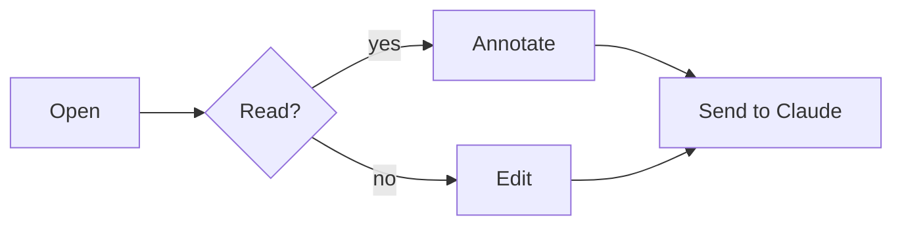
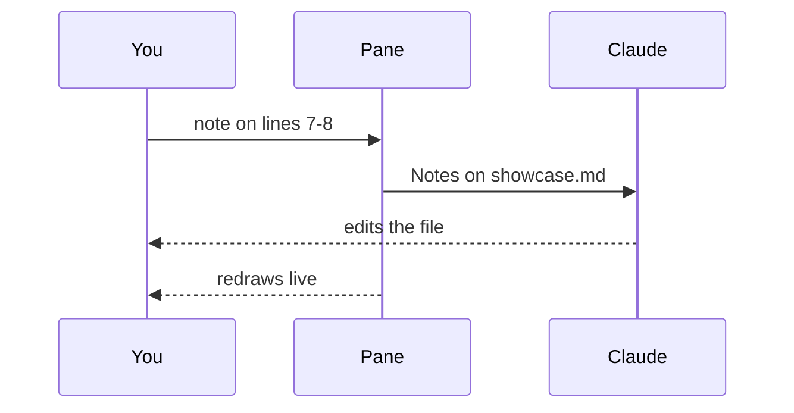
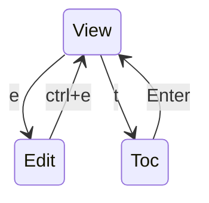

# claude-leaf showcase

A tour of everything the pane draws. Scroll with the **mouse wheel**, or click
the pane and use `j` / `k`. Press `t` for the table of contents, `/` to search
for the word *needle*, and `e` to edit this file.

## Text

Plain text with **bold**, *italic*, ***both***, ~~struck out~~ and `inline code`.
A [link to leaf](https://github.com/RivoLink/leaf) and an autolink:
<https://catppuccin.com/palette>. Escaped \*stars\* stay as they are.

A second paragraph, long enough to wrap when the pane is narrow: the quick brown
fox jumps over the lazy dog while the needle hides somewhere in this sentence.

## Lists

- First bullet
- Second bullet
  - Nested bullet
    - Deeper still
- Back at the top

1. Ordered one
2. Ordered two
3. Ordered three

- [ ] An open task
- [x] A finished task
- [ ] Another open task, with `code` inside

## Quotes

> A single quote, drawn with a bar.
>
> > A quote inside a quote.

## Tables

| Flavour    | Base      | Accent    | Dark? |
|:-----------|:---------:|----------:|:-----:|
| Mocha      | `#1e1e2e` | mauve     | yes   |
| Macchiato  | `#24273a` | blue      | yes   |
| Frappé     | `#303446` | peach     | yes   |
| Latte      | `#eff1f5` | red       | no    |

## Code

```ts
// a keyword, a string and a comment in each line
const greet = (name: string): string => `hello, ${name}`
export function main() {
  return greet('leaf') // the needle is not here
}
```

```sh
claude --plugin-dir claude-leaf
/leaf claude-leaf/examples/showcase.md
```

## Diagrams

A flowchart:



A sequence diagram:



A state diagram:



---

## Things to try

1. **Wheel**: scroll this page without clicking it.
2. **Note**: click the line *A single quote, drawn with a bar*, press Enter,
   type a comment, press Enter, then `s`. The note lands in the prompt box.
3. **Edit**: press `e`, type something, `ctrl+s`, then `ctrl+e`.
4. **Live reload**: ask Claude to add a row to the table above.
5. **Search**: `/needle`, Enter, then `n` to step through the hits.
6. **Picker**: `o`, then type `read` to find a README.

<!-- an HTML comment, drawn dim -->

The end. One last needle for the search.
