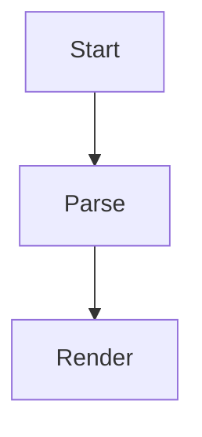

# Leaf Fixture

A **bold** start with *italic*, `inline code` and a [link](https://example.com).

## Diagram



## Table

| Name | Count |
|------|------:|
| alpha | 1 |
| beta | 22 |

## Code

```ts
const answer = 42 // the number
console.log('xyz', answer)
```

## List

- first item
- second item
  - nested item
- [ ] open task
- [x] done task

> A quoted line with xyz inside.

---

## Tail

The last paragraph mentions xyz once more.
